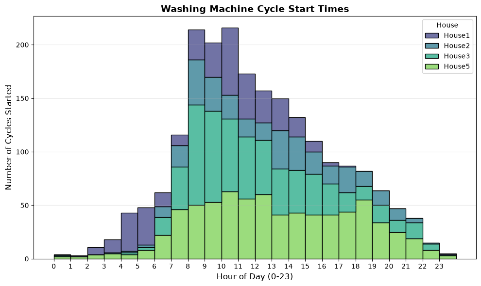
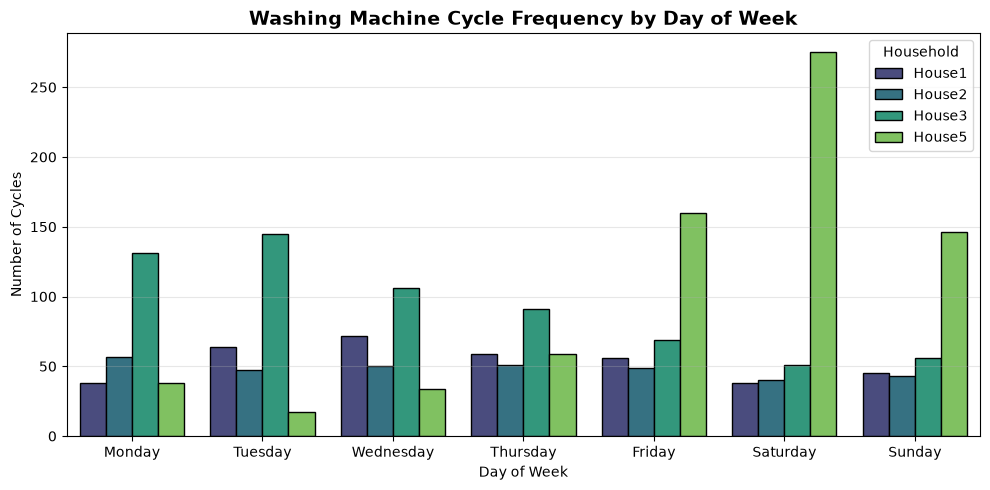
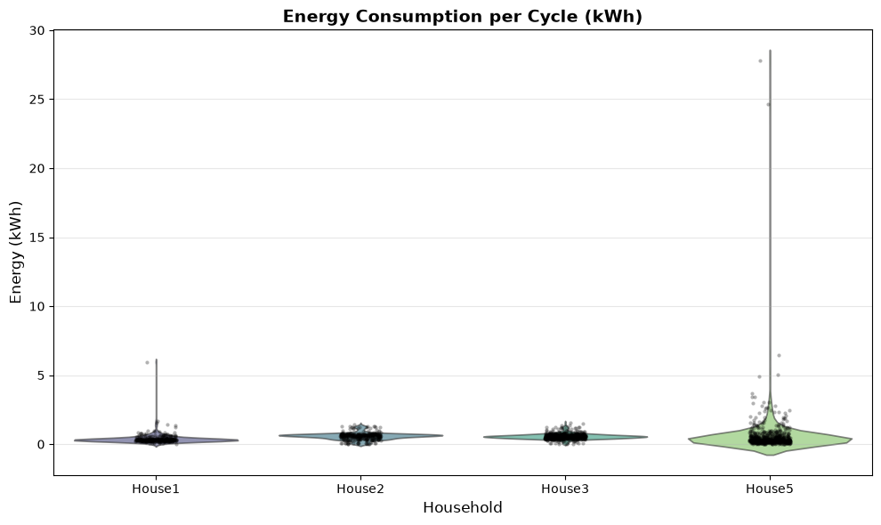
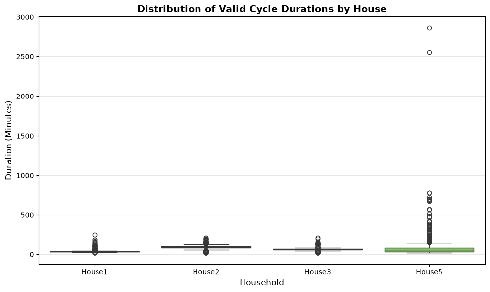
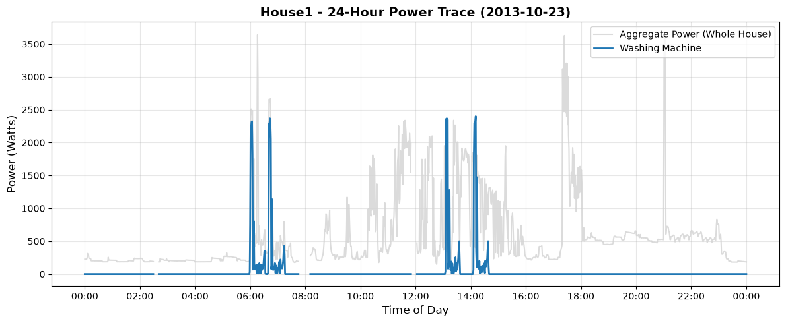
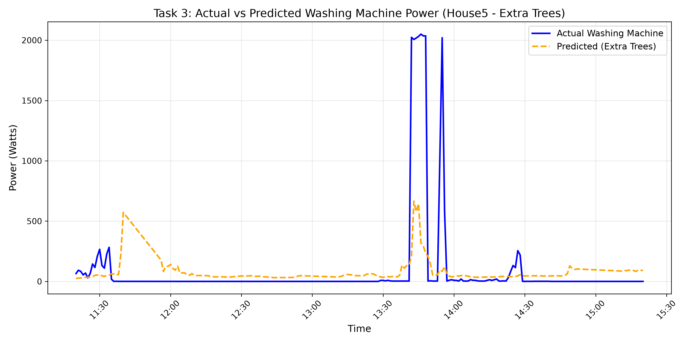

# Task 2
## 1. Cycle Detection Methodology & Validation Approach

### 1.1 Detection Rules

* **Active Power Threshold (`POWER_THRESHOLD = 50`):** The appliance transitions to an active state when power consumption strictly exceeds 50 Watts, bypassing standby/phantom loads.
* **Missing Data Hard-Break:** Unpopulated (`NaN`) gaps act as an immediate cycle terminator. Cycles are strictly prohibited from bridging across missing sensor periods.
* **Intra-Cycle Gap Bridging (`MAX_GAP_MINUTES = 15`):** Mid-cycle power drops below 50W (representing internal soaking or resting phases) are grouped into the current continuous cycle, provided the appliance returns to an active state within 15 minutes.
* **True Duration Metric:** Cycle length is calculated strictly from the first active minute (>50W) to the last active minute (>50W). Trailing inactive gaps used for state validation are stripped to prevent artificial duration inflation.
* **Noise Filter (`MIN_CYCLE_MINUTES = 20`):** Any detected event with a true duration of less than 20 minutes is classified as hardware noise and discarded.

### 1.2 Threshold Validation

The 20-minute minimum duration threshold was derived empirically. Exploratory plotting of raw event durations on a logarithmic scale revealed a massive frequency spike of 1-to-10-minute events (sensor glitches and brief manual interactions). This noise distribution steeply decayed, hitting a definitive trough at exactly the 20-minute mark before rising again into a secondary curve representing true mechanical wash cycles (peaking at 30-40 minutes). Placing the cutoff within this mathematical valley safely amputates hardware noise while preserving genuine appliance loads.

---

## 2. Washing-Machine Exploratory Data Analysis (EDA)

### 2.1 Time-of-Day and Day-of-Week Patterns

#### Usage Patterns: Time-of-Day

* **Observation:** Washing machine usage strictly follows a diurnal pattern tied to human waking hours. Activity is almost non-existent between midnight and 6 AM, surges rapidly in the early morning to a distinct peak between 8 AM and 12 PM, and then steadily declines throughout the afternoon and evening.

* **Conclusion Justification (Why we conclude this):** The strict absence of overnight activity mathematically validates the cycle detection rule. If the state machine were capturing random sensor noise or standby power glitches, the distribution would be flat or scattered across all 24 hours. The morning peak perfectly reflects real-world human behavior of starting chores at the beginning of the day.

#### Usage Patterns: Day-of-Week

* **Observation:** Household lifestyle routines dictate completely different weekly scheduling:

* **House 1 & House 2:** Exhibit relatively flat, consistent usage across the entire week with only minor fluctuations, indicating a routine of smaller, daily laundry loads.

* **House 3:** Shows a strong early-week bias, peaking on Monday and Tuesday before trailing off toward the weekend.

* **House 5:** Exhibits an extreme weekend-heavy profile. Usage is nearly zero from Monday through Wednesday, begins climbing on Friday, and culminates in a massive volume spike on Saturday and Sunday.

* **Conclusion Justification:** We can definitively conclude that House 5 "batches" their laundry for the weekend, likely due to weekday work/school constraints, whereas Houses 1 and 2 integrate the chore into their daily schedules.

## 3. Cross-Household Comparison & Model Results

* **Observation (House 1 - Rapid Modes):** House 1 relies almost exclusively on short wash cycles clustered under 60 minutes. Consequently, its energy footprint is the smallest, consistently drawing less than 1 kWh per cycle.

* **Observation (Houses 2 & 3 - Eco/Standard Modes):** Both homes show a tightly clustered median duration of 80 to 100 minutes per cycle. Their energy consumption is highly predictable, falling strictly between 0.5 and 2.0 kWh per load.

* **Observation (House 5 - Severe Anomalies):** While House 5's median duration matches House 2, it contains extreme outliers that stretch up to nearly 3,000 minutes (approx. 48 hours). These massive durations correlate with unprecedented energy spikes, drawing up to 30 kWh in a single continuous event.

---

The analytical distributions reveal stark contrasts in machine settings across the four households within the REFIT dataset.

| Household | Cycle Volume | Median Duration | Typical Energy / Cycle | Behavioral Classification |
| --- | --- | --- | --- | --- |
| **House 1** | 450 | < 60 mins | < 1.0 kWh | Rapid / Quick Wash reliance. |
| **House 2** | 406 | 80 - 100 mins | 0.5 - 2.0 kWh | Standard / Eco mode reliance. |
| **House 3** | 805 | 80 - 100 mins | 0.5 - 2.0 kWh | Standard / Eco mode reliance. |
| **House 5** | 1,148 | 80 - 3000+ mins | 0.5 - 30.0 kWh | Extreme Outliers (Hardware Faults). |

---

## 4. Failure Analysis: The House 5 Anomaly

While Houses 1, 2, and 3 behave within expected physical constraints, House 5 introduces significant outliers in both time and power. While its median duration aligns with House 2, it contains extreme cycle lengths stretching up to nearly 3,000 minutes (approximately 48 hours).

These ultra-long durations perfectly correlate with unprecedented energy spikes, drawing up to 30 kWh in a single continuous event. Because a 48-hour active physical wash cycle would destroy clothing and far exceeds the maximum programmable limits of modern European appliances (typically 3-4 hours / 2-3 kWh), these events do not represent intentional human behavior.

Instead, these outliers indicate severe appliance malfunctions (such as a continuously running drain pump, a stuck heating relay, or an unresolved error state keeping the machine active while the household was away). Consequently, the cycle detection rules not only map human usage patterns but successfully function as an automated anomaly detection system for failing hardware.

### 5. 24 hour analysis of aggreggate vs washing maching power consumption

# Task 3

## 1. Data Scope and Splitting Strategy

* **Data Included:** The model processes the official cleaned REFIT data at a 1-minute resolution. The evaluation spans multiple households (e.g., House 1, House 2, House 5).
* **Train/Test Split:** A **chronological 80/20 split** was utilized for each household (the first 80% of the timeline for training, the final 20% for testing).
* **Avoiding Data Leakage:** Randomly sampling time windows in time-series data causes severe data leakage, as the model could theoretically use a Wednesday afternoon to predict a Wednesday morning. Chronological splitting strictly enforces the temporal arrow of time, forcing the model to predict completely unseen future appliance usage based only on past behavior.

## 2. Model Selection and Baseline Comparison

* **The Baseline:** An "Always-Off" baseline was established, representing a model that permanently predicts 0W.
* **The Model:** An **Extra Trees Regressor** was selected as the final architecture.
* **Justification:** While highly complex models (like Neural Networks or K-Nearest Neighbors) were tested, Extra Trees provided the optimal balance of classification accuracy (F1-score), robustness against overlapping appliance noise (due to its randomized node splitting), and computational scalability for local execution across 15+ households.

## 3. Metric Selection and The Sparsity Paradox

* **F1-Score (Primary):** Because the washing machine is inactive for roughly 95% of the dataset, traditional accuracy is highly misleading. The F1-Score evaluates the model's true capability to correctly detect binary ON/OFF states (>=50W threshold) without being overwhelmed by the massive class imbalance.
* **Mean Absolute Error (Secondary):** MAE measures the raw deviation in Watts. Comparing the model MAE against the baseline MAE physically illustrates the **Sparsity Paradox**. The baseline often achieves a lower MAE (~40W) simply because it correctly guesses 0W for 95% of the time. The Extra Trees model incurs a higher MAE (~49W) because a single false positive (guessing the washing machine is drawing 2000W when it is actually 0W) inflicts a massive mathematical penalty.

## 4. Actual vs. Predicted Evaluation**

## 5. Failure Cases
By visually analyzing the evaluation data in the House 5 plot, the Extra Trees model demonstrates two distinct failure modes:

* **Coincident False Positives:** Around 11:45, the model predicts a usage spike of over 500W, but the actual washing machine is at 0W. This occurs when another heavy appliance (like a kettle or microwave) creates an aggregate power spike that perfectly mimics the signature of the washing machine's heating element, tricking the model into predicting a false cycle.
* **Peak Under-Prediction:** Around 13:45, the actual washing machine enters an intense phase drawing over 2000W. The model successfully detects that the machine is ON, but severely under-predicts the magnitude, capping out near ~650W. This happens because tree-based ensembles inherently average the predictions of many trees, which can artificially smooth out extreme, rigid mechanical peaks in the testing data.
